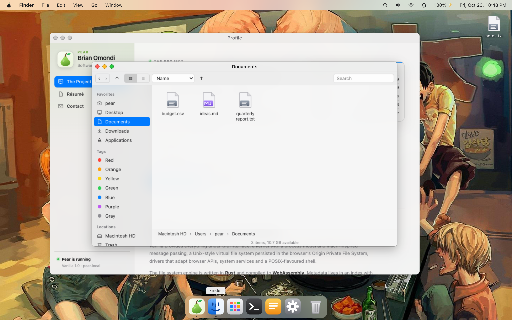
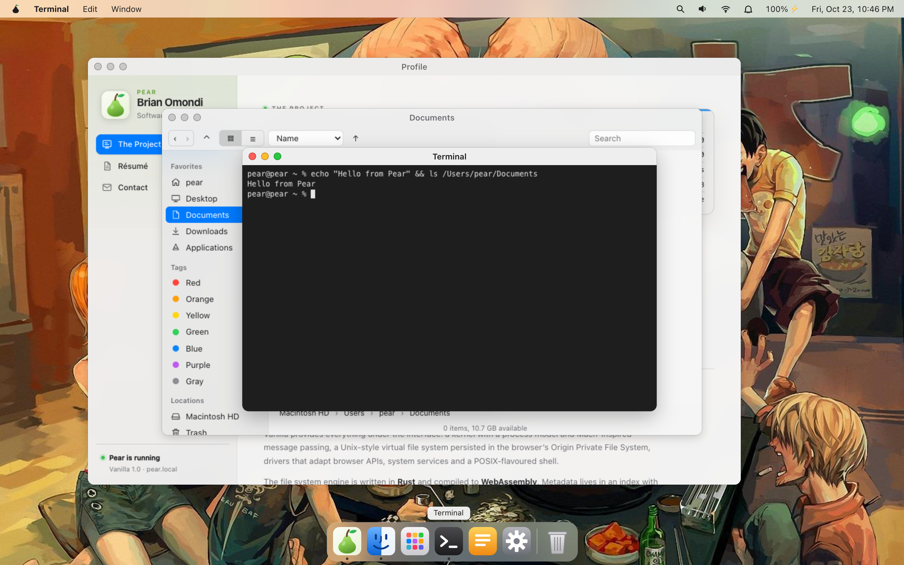
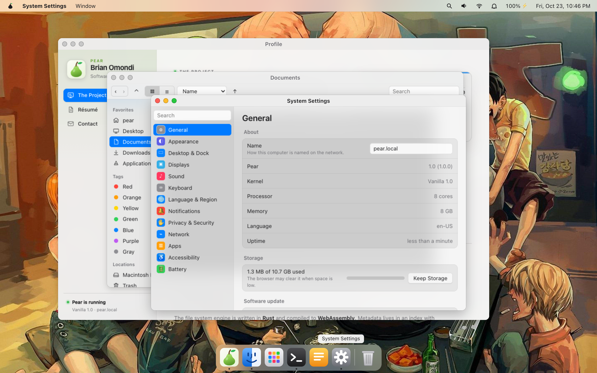
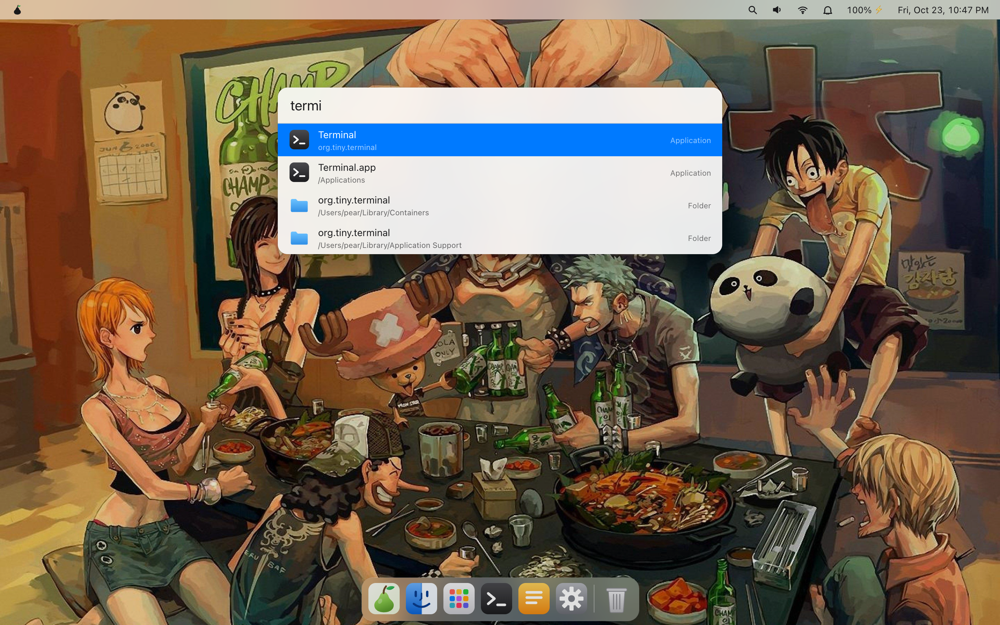

<p align="center">
  
</p>

<h1 align="center">Pear</h1>

<p align="center">
  A lightweight, macOS-inspired operating system that runs entirely in the browser.<br/>
  No install, no account, no server-side data. Close the tab and nothing is lost;<br/>
  reopen it and your session comes back.
</p>

<p align="center">
  <a href="#how-it-works">How it works</a> ·
  <a href="#running-it-locally">Running it locally</a> ·
  <a href="#vanilla-the-core-os">Vanilla</a> ·
  <a href="#desktop-the-interface">Desktop</a>
</p>

Everything you see below is running locally in the tab — a small kernel, a Unix-style file system, sandboxed processes and a desktop with apps.


|  |  |
|---|---|
|  |  |

Pear is split into two layers:

| Layer | Directory | Role |
|-------|-----------|------|
| **Vanilla** | [`vanilla/`](./vanilla/) | The core OS: kernel, process model, virtual file system, drivers, system services. A derivative of Darwin (Apple's open-source operating system), reimplemented for the web platform. |
| **Desktop** | [`desktop/`](./desktop/) | The macOS-inspired user interface: window manager, dock, menu bar, Finder-like file browser, launcher, and 20+ bundled apps. Built on top of Vanilla's public APIs. |

## Goals

- **Fast.** Boot to a usable desktop in about a second on a modern machine. Minimal dependencies, small bundles, lazy-loaded apps.
- **Efficient.** Low memory and CPU use. Idle means idle: no busy loops, no unnecessary repaints.
- **Easy to use.** Familiar macOS conventions (menu bar, dock, windows, keyboard shortcuts) so no one needs a manual.
- **Self-contained.** Everything runs client-side. Closing the tab loses nothing; reopening restores the session.
- **Hackable.** A small, readable codebase meant for learning how an OS is put together.

## Non-goals

- Running native macOS binaries or being binary-compatible with Darwin.
- Multi-user accounts, networking between machines, or server-side sync.
- Pixel-perfect cloning of macOS. Pear is *inspired by* it.

## How it works

Pear runs entirely in the client's browser and builds on standard web APIs:

| Concern | Technology |
|---------|------------|
| Compute-heavy and native-style code | **WebAssembly**: the kernel's file system engine and userland tools (Rust → wasm) |
| Graphics and compositing | **WebGL**: window compositing, effects, GPU-accelerated apps |
| File system | **OPFS** (Origin Private File System): fast, persistent storage backing the virtual file system |
| Configuration and state | **LocalStorage**: preferences, window layout, dock contents, last session |
| Concurrency | **Web Workers**: each process runs isolated from the UI thread |

### Vanilla (the core OS)

Vanilla takes its design from Darwin: a Unix-like foundation with a small kernel, a process model, and a POSIX-flavoured userland — reimplemented for the browser rather than run on hardware.

- **Kernel**: scheduler, process table, and message passing (Mach-inspired IPC) over Web Workers.
- **Virtual file system (VFS)**: a Unix-style hierarchy (`/`, `/Users`, `/Applications`, `/System`) mounted on OPFS, with files, directories, permissions, and metadata. The engine is written in Rust with a write-ahead journal and crash recovery.
- **Syscall layer**: a stable, documented interface (`open`, `read`, `write`, `spawn`, ...) that the Desktop and apps call into.
- **Drivers**: thin adapters over browser APIs for display, input, audio, clipboard, and timers.
- **Shell and core utilities**: a terminal-friendly userland (`ls`, `cat`, `cp`, ...), compiled to WebAssembly where practical.
- **System services**: launch, settings, notifications, search, network, and an app registry.

See [`vanilla/README.md`](./vanilla/README.md) for the architecture and how to test the kernel locally.

### Desktop (the interface)

Desktop is a client of Vanilla. It never touches OPFS or LocalStorage directly; it goes through the syscall layer.

- **Window manager and compositor** with focus, stacking, minimize to the dock and maximize
- **Menu bar** with app-specific menus and system status items (clock, volume, battery, notifications)
- **Dock** with pinned apps, running indicators, magnification, and a Trash
- **Finder-like file browser** over the VFS
- **Spotlight-style launcher** (`Alt+Space`) for apps, files, settings and quick calculations
- **Bundled apps**: Finder, Terminal, TextEdit, Notes, Safari, Music, QuickTime Player, Preview, Maps, Reminders, Clock, Calculator, Settings, Activity Monitor, Console, Weather, Stocks, News, Books, Freeform, Voice Memos and more

See [`desktop/README.md`](./desktop/README.md) for details.

## Persistence model

| Data | Stored in | Why |
|------|-----------|-----|
| Files and directories | OPFS | Large, binary-friendly, fast synchronous access from Workers |
| Preferences, theme, dock layout, window positions | LocalStorage | Small, simple key/value, synchronous reads at boot |
| Running processes | Memory only | Rebuilt on boot from saved session state |

Because everything lives in the browser profile, clearing site data resets Pear to a fresh install. Disk images (a downloadable, verifiable backup of the whole file system) can be exported and restored from System Settings.

## Boot sequence

1. Load the Vanilla kernel (WebAssembly) and open the OPFS file system, creating the default hierarchy on first run.
2. Read configuration from LocalStorage.
3. Start system services as Web Workers.
4. Launch Desktop, restore the previous session's windows and dock, and show the menu bar.

## Security and isolation

- Each process runs in its own Worker inside a sandboxed iframe; communication is via message passing only.
- Apps reach the system only through the syscall layer and are subject to VFS permissions and capability prompts.
- Nothing leaves the browser unless the user explicitly exports or downloads it. (The public deployment includes one optional stateless proxy so Safari can read sites that do not allow CORS; it stores nothing.)

## Running it locally

```bash
pnpm install
pnpm --filter @tiny/kernel build   # builds Vanilla; Desktop serves its output at /os/
cd desktop
pnpm dev                           # http://localhost:5173  (add ?ns=name for a separate file system, ?safe for safe mode)
pnpm test                          # end-to-end tests of the whole OS
```

## Browser support

Targets Chromium-based browsers (Chrome, Edge, Brave) with WebAssembly, WebGL 2, OPFS, and Web Workers. Firefox is a target as well; Safari is not.

